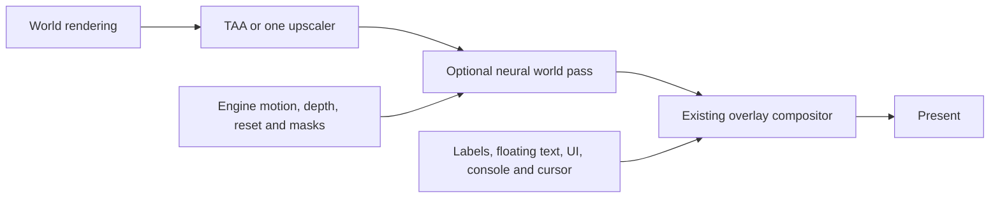

# DLSS 5 and neural rendering feasibility

2026-10-29. Baseline: fork `main` at `ab587fd30ec3384b36a1d1dd7f99615e2ad46578`, tagged
`known-working-0.8`: ao-vk 0.8.0 with the UI and terrain fixes. This study changes documentation only.

## Decision

**Conditional go for small feasibility probes; no-go for a production integration yet.** Genuine DLSS 5 Neural
Rendering is obtainable from an official NVIDIA dependency package, and NVIDIA's Remix source demonstrates a
Vulkan integration. Neither proves that an independent ao-vk application can create the feature under Wine.
The inspected runtimes cannot load into the game's 32-bit process. No AO neural output, RTX 5080 timing, VRAM
measurement or latency result was produced in this study.

Prefer existing components before building a bridge. ReShade is a useful permissively licensed framework;
DLSS5-Feeder has reusable cross-bitness transport, but its present 32-bit Vulkan route explicitly stops under
Wine by default. OptiScaler's NR forks and Linux Vulkan layers are useful comparisons, with compatibility,
runtime-access and licence conditions described below. None is a verified drop-in solution for this baseline.

Preserve the existing overlay compositor. Neural processing must consume the world, before names, floating
text, windows, HUD, console and cursor. A successful mod applied to the final presented image would demonstrate
runtime execution, but would not satisfy this fork's integration requirements.

## What is established

[NVIDIA's research](https://research.nvidia.com/labs/adlr/DLSS5/) describes an appearance-generation stage using
frame colour, engine motion, temporal state and artistic controls. It is distinct from DLSS Super Resolution
(SR), Ray Reconstruction (RR) and Frame Generation (FG). It does not require replacing rasterization with path
tracing. The [developer overview](https://developer.nvidia.com/blog/whats-new-for-game-developers-dlss-5-with-3d-guided-neural-rendering-nvidia-ace-updates-and-new-rtx-kit-capabilities/)
identifies RTX 50-series support, model/structure/tone controls and masks. These establish a plausible target
for the user's RTX 5080, not Wine support or AO image quality.

The public [Streamline 2.14.16 release](https://github.com/NVIDIA-RTX/Streamline/releases/tag/v2.14.16) was downloaded
and inspected, rather than inferred from its changelog. Its x64 ZIP has 511 entries, a feature identifier
`kFeatureDLSS_NR = 1004`, and the changelog entry for `sl.dlss_nr`, but no NR plugin DLL, model DLL or feature guide.
The x64 interposer is PE machine `0x8664`. Other architecture ZIPs were not downloaded. Streamline's general
Vulkan support and DLSS branding do not establish availability of this particular plugin.

There is a stronger official route: Remix's
[dependency declaration](https://github.com/NVIDIAGameWorks/dxvk-remix/blob/0ba9973fd856e29fe9cf8dd2f2bc754bcbb2037a/packman-external.xml)
names `rtx-remix-ngx_sdk_dlnr` version 2. Its
[public download configuration](https://github.com/NVIDIAGameWorks/dxvk-remix/blob/0ba9973fd856e29fe9cf8dd2f2bc754bcbb2037a/scripts-common/packman/config.packman.xml)
leads to the [NVIDIA-hosted package](https://d1oqksizpb0e3d.cloudfront.net/rtx-remix-ngx_sdk_dlnr@2.7z). Inspection found:

- Windows x64 and ARM64 `rel/nvngx_dlssnr.dll`; no x86 DLL or Linux NR library in this package.
- x64 runtime version **310.9.16.0**, 266,424,944 bytes, machine `0x8664`; Vulkan create/evaluate, requirements,
  extension-query and lifetime exports, plus D3D12 exports. A certificate table is present; signature trust was
  not cryptographically verified here.
- NR definitions and Vulkan helpers, including `nvsdk_ngx_helpers_dlssnr_vk.h`, plus an NVIDIA RTX SDK licence.
  The package is an NR extension, not a complete standalone NGX SDK: it has no NGX link library, and its headers
  also depend on the base SDK. It is not a Streamline NR plugin package.

NVIDIA's [Remix Vulkan call site](https://github.com/NVIDIAGameWorks/dxvk-remix/blob/0ba9973fd856e29fe9cf8dd2f2bc754bcbb2037a/src/dxvk/rtx_render/rtx_dlss_neural_rendering.cpp)
and [NGX wrapper](https://github.com/NVIDIAGameWorks/dxvk-remix/blob/0ba9973fd856e29fe9cf8dd2f2bc754bcbb2037a/src/dxvk/rtx_render/rtx_ngx_wrapper.cpp)
show feature creation, capability checks, colour/motion/depth/control-mask resources, reset, jitter, subrects,
motion scaling and effect controls. The runtime owns temporal state behind the feature handle. Feature identity
is the former reserved NGX slot 18. The wrapper also exposes an SDK allocation statistic; it excludes renderer
textures. This is concrete Vulkan API evidence, not a guarantee of supported deployment outside Remix.

### Acquisition and licensing

The package supplies the [NVIDIA RTX SDK licence](https://github.com/NVIDIA/DLSS/blob/9981c6350dc58c0ce21f024fd65e31e851c31689/LICENSE.txt),
dated March 14, 2024. It permits SDK use and conditional application redistribution; it is not MIT. Relevant
conditions include application functionality, protective distribution terms, notices, NVIDIA hardware, commercial
release notification and branding. It restricts SDK modification, reverse engineering and technical-limit
circumvention. The actual package licence must accompany any eventual distribution review.

Official acquisition is established. A supported way to invoke NR with our own application identity under Wine
is still unproven. Use ao-vk's own project identity and the normal NGX path in a probe. If that fails, record the
result and request NVIDIA's supported package/enablement route; do not borrow another game's identity, patch the
runtime or assume a community caller-gate shim is an approved integration. No message to NVIDIA was sent.

Keep NVIDIA binaries outside the MIT source tree. Reused third-party code must retain its original notices;
authorship of new ao-vk work does not replace those notices. GPL/AGPL components cannot be copied into ao-vk and
presented as MIT-only. Separate optional programs still require their own licence and distribution review.

## Fit with ao-vk 0.8

AO calls a 32-bit `randy31.dll`; ao-vk implements the legacy DirectDraw/D3D7-facing interfaces and renders with
Vulkan 1.3. This is not an ordinary D3D11/12 game running through DXVK. Dropping `dxgi.dll`, an x64 add-on or an
NGX replacement beside the game does not manufacture an interception point that ao-vk calls.

| Resource or boundary | Present in this baseline | Work before an NR integration |
| --- | --- | --- |
| World colour | [EndScene](../rvk/hdr.cpp) tone-maps, resolves/upscales and optionally blurs into `m_ldrMain`; overlays follow | Pin the chosen boundary and colour transfer; supply a distinct writable NR output and retain the original for fallback. |
| Depth | Native scene depth is 0 near, 1 far; display-sized depth may be upsampled later | Preserve scene depth and its dimensions before upsampling; validate format, projection and sky handling against the chosen runtime. |
| Engine motion | [draw.cpp](../rvk/draw.cpp) matches meshes/world matrices and previous CPU/GPU-skinned positions; [FsrInputs](../rvk/fsr2.cpp) produces RG16F motion | Verify coverage and conventions. Values are current-minus-previous in scene pixels; FSR negates them. Do not copy that sign blindly into NGX. |
| Missing motion | [motion_fill.frag](../rvk/shaders/motion_fill.frag) reconstructs camera motion where object motion is absent/zero | Test particles, alpha surfaces, water, foliage deformation, duplicate meshes, disocclusion and fast movement. Camera reprojection is not a substitute for their motion. |
| Jitter/history | [TaaParams](../rvk/hdr.cpp), previous camera and continuity checks support TAA/FSR/FG | Specify pixel centres, jitter units/sign, frame ID and reset on cuts, zoning, size changes and worker restarts. |
| Effect mask | No dedicated NR control mask | Package defines four channels: intensity, local tone, local structure, unused alpha. Define preservation policies and neutral values with the SDK; the FSR reactive mask has different semantics. |
| UI/overlays | [interface.cpp](../rvk/interface.cpp) retains layers; `ComposedFrame` builds composed readback separately | Keep all overlays downstream of NR, also with FG off and cached UI frames. Do not depend on inferred HUD detection. |
| Process boundary | [threaded.cpp](../rvk/threaded.cpp) moves work to a thread in the same process | An x64 worker needs IPC and shared-resource lifetimes; a render thread does not solve bitness. |
| GPU sharing | No external-memory/semaphore import/export implementation was found in `rvk/` | Query and enable required extensions/features at device creation; test handles, matching GPU UUID, ownership transfers and timeout recovery under the actual Wine build. |
| FG/present | [framegen.cpp](../rvk/framegen.cpp) uses AMD's Vulkan replacement swapchain and separate overlays | Start with FG off. Later test NR output as the world input to existing FG; do not stack competing presentation/interpolation owners. |

The current motion path is conditional on TAA or object-motion blur and requires a valid previous camera.
An NR option would need its own input-generation demand; turning off AA must not silently stop its guides.
Object matching includes a three-unit proximity search and topology/texture keys. Existing FSR functionality
is useful evidence, not proof of complete geometric correspondence in crowds, fast movement or changing LODs.

The initial candidate is display-sized, resolved world colour after current world post-processing and before
held labels. Test motion blur off first. Native colour is an 8-bit target; an HDR-before-tonemap route would need
the SDK's colour contract and extra preservation work. Package headers expose resources and subrects, but do
not establish every accepted format, colour space or mixed-resolution rule. Remix is a reference, not permission
to guess these rules. Export the original render-size guides alongside output-size colour until verified.

Conceptually, the intended ordinary-frame path is:

This is an integration boundary, not an SDK-mandated pass order. FG and zone handover require separate ordering
tests. Login and loading screens should bypass NR and reset history when gameplay resumes.

## Third-party routes

The following are source/documentation findings, not local AO compatibility results. Versions are pinned in
the evidence section; an installer's broad compatibility claim is not a result for this game's process/API.

| Route | Useful reuse | Verdict for this fork |
| --- | --- | --- |
| ReShade | x86/x64 Vulkan support, effect runtime, explicit texture bindings, add-on callbacks and manual effect execution; BSD-3-Clause with some dual MIT APIs | Good candidate for a controlled test host or adapter. ReShade alone is not DLSS 5 and provides no x86 NVIDIA runtime. Default present-time effects see composed UI. |
| Stock OptiScaler | SR/FG backend adapters and UI/resource handling for existing DLSS/FSR/XeSS calls; GPL-3.0 | No direct installation route: x64 builds and no intercepted SDK calls in ao-vk's statically linked x86 FSR implementation. Stock SR/FG support does not imply NR. |
| OptiScaler NR forks | Actual NR create/evaluate and composition code; Dagherbou's fork includes native Vulkan as well as D3D12/bridged paths | Useful comparison in an x64 test host. Still needs an input call site, supported runtime access and licence compliance; not an x86 solution. |
| RenoDX / DLSS add-ons | Open RenoDX has MIT colour, shader and NGX-hook utilities; particular community NR add-ons are separate artifacts | Investigate the exact artifact, source and licence. An open RenoDX repository does not establish provenance or terms for every Discord NR binary. x64 hooks alone cannot process this x86 renderer. |
| DLSS5-Feeder | MIT x86 add-on, x64 helper, shared colour/depth/motion/output, transport-only mode, resource rebuild and failure handling | Best permissive reference for a small post-process bridge. Its present x86 Vulkan/Wine fence gate blocks unmodified use. Replace estimated guides and late colour with engine inputs if adapting it. |
| DLSS5VKLayer / Plus | Linux x86/x64 layers and an x64 Windows Vulkan helper under Wine; existing IPC, composition and runtime diagnostics | Useful Linux execution experiment, not the production boundary. The inspected upstream is AGPL-3.0, intercepts present and estimates motion; sharing can involve host memory and CPU synchronization. |
| Linux ReShade NR add-ons | NapXDD and derivatives demonstrate community x64 Proton NR work | Examined version needs active DLSS-SR and a D3D12 ReShade setup; GPL-derived and uses direct snippet/caller-gate forwarding. Not a direct ao-vk path or evidence for the official package's supported API. |
| RTX Remix | Official Vulkan NR integration and x86-to-x64 D3D9 bridge; permissive notices on relevant source | Prefer as SDK/architecture reference. Its bridge serializes D3D9 and its renderer reconstructs/path-traces scenes; it is not a finished-image NR service for ao-vk's Vulkan device. Whole-renderer adoption is a separate remaster. |
| Capture tools, Lossless Scaling add-ons, neural-lens | Quick look experiments with little game modification | Final-frame capture lacks our engine guides and processes UI. May inform appearance preferences, but cannot qualify engine integration, temporal correctness or its latency. |
| dgVoodoo2 / DDraw-to-D3D9 wrappers | Can translate an original legacy renderer into a graphics API supported by other injectors | Would replace/bypass this baseline's renderer path and risk its terrain/UI work. No reason to insert them ahead of a direct Vulkan experiment. |

[ReShade's API](https://github.com/crosire/reshade/blob/7bf9de8b33bcc76c3177007e65d73c72dd0f34c0/include/reshade.hpp)
can create an effect runtime around an existing Vulkan device/queue/swapchain. Its
[effect interface](https://github.com/crosire/reshade/blob/7bf9de8b33bcc76c3177007e65d73c72dd0f34c0/include/reshade_api.hpp)
supports texture-semantic updates and rendering a technique on a selected render target. That provides a
potential explicit world-boundary adapter rather than generic draw-call guessing. The actual Vulkan layer,
device wrapping, resource registration and command-buffer state still need testing; raw Wine Vulkan handles
must not be mistaken for interchangeable native Linux handles.

DLSS5-Feeder's current
[x86 implementation](https://github.com/jlrouzies-fr/DLSS5-Feeder/blob/16cb1946a8331751b0f89a728b797d895ecdfba1/src/dlss5-feed32.cpp)
imports helper-created D3D12 textures and fences into Vulkan. It explicitly refuses the fence step under Wine
unless `wine_fence_import` is overridden, citing a cross-process import failure that can terminate the game.
That source guard takes precedence over its older Windows-only Vulkan spike results. Do not override it as
an installation suggestion. Its
[IPC contract](https://github.com/jlrouzies-fr/DLSS5-Feeder/blob/16cb1946a8331751b0f89a728b797d895ecdfba1/src/feed_ipc.h)
also documents a pipelined option returning the previous frame: overlap has a latency and alignment cost.

The inspected [Linux Vulkan layer](https://github.com/bmitch87/DLSS5VKLayer/blob/c77b64c9826a3b7c741c8b160fbd0b2c29a8eae3/layer_linux/src/layer.cpp)
has shared-memory request/response waits, host-memory fallback and optional faster transport. Its
[helper](https://github.com/bmitch87/DLSS5VKLayer/blob/c77b64c9826a3b7c741c8b160fbd0b2c29a8eae3/helper/main.cpp)
estimates motion through optical flow because its input is a presented picture. Avoid describing this whole
route as a proven zero-copy engine integration. The
[NR OptiScaler module](https://github.com/Dagherbou/OptiScaler_DLSSNR/blob/973761621353b99bee3dc7d4bb27b117fef2644f/OptiScaler/dlssnr/README.md)
likewise documents a caller-gate shim. A mod successfully reaching the model does not settle SDK-authorized
invocation. Those techniques are not prerequisites for using the official NGX interface.

### Other neural approaches

| Approach | Benefit and cost relative to the target | Decision |
| --- | --- | --- |
| DLSS SR/DLAA, ML FSR or XeSS | Reconstruct detail/AA rather than generate new material/lighting appearance. They still need correct temporal guides and a supported runtime/process. | Useful separate quality/performance comparison; not a substitute labelled DLSS 5. Retain current TAA/FSR controls. |
| DLSS RR and neural denoisers | Improve appropriately separated noisy lighting signals; our combined raster colour is not that contract. | Defer until a suitable ray-traced signal pipeline exists. |
| RTX Neural Radiance Cache | [NRC](https://github.com/NVIDIA-RTX/RTXGI/blob/main/Docs/NrcGuide.md) learns radiance from a path tracer. Existing ray queries/reflections do not supply that training pipeline. | Larger lighting project, not a final-world appearance plug-in. |
| RTX Neural Shading / Neural Texture Compression | [RTXNS](https://github.com/NVIDIA-RTX/RTXNS) and [RTXNTC](https://github.com/NVIDIA-RTX/RTXNTC) support shader/material workflows, including Vulkan facilities. Need model/material preparation and shader integration. | Possible later asset/material work; neither automatically adds missing AO detail. |
| Offline texture/material enhancement | Review regenerated assets once and render them normally. Lower runtime uncertainty and direct control of AO style. | Credible alternative if live NR fails; use assets with appropriate rights and retain approved originals. |
| General diffusion/video enhancement | Requires a model, temporal conditioning, identity controls and substantial inference integration. Independent-frame image filters are inadequate. | No production recommendation without temporal 4K performance and asset-fidelity evidence. |
| Community NR network reimplementations | May change platforms or hardware requirements, but code licences do not automatically grant rights to model weights or extracted SDK content. | Not an established licence-clean replacement for the official runtime; assess separately before adoption. |

## Visual benefit: how to decide

AO's age does not prevent NR input, but there is no evidence yet that its stylized characters and low-detail
assets improve without unwanted reinterpretation. Expected opportunities are foliage, fabric, material response,
contact shading and broad lighting. Risks include invented face/clothing detail, changed faction colours,
illegible world signage, unstable fine detail, altered silhouettes and spell effects that become harder to read.
These are hypotheses to test, not observed results.

Compare the identical world sequence with NR off and each available model at restrained structure/tone settings.
Use static cameras and motion clips: Old Athen architecture/pavement; Shadowlands terrain/void; close character
faces and armour; crowds and combat; foliage/water; night, rain and fog; indoors and emissive signs. Include
zoning, login/loading, occlusion, camera cuts and rapid turns. Do not judge temporal quality from still images.
Record the model/preset separately: SDK render presets and appearance model/style controls are different knobs.

Require the user to prefer the restrained result in several representative scenes, with no changed gameplay
information, persistent flicker or identity loss. Compare a one-pass result first; multipass examples have extra
cost and may exaggerate the style. Save matched world-only and composed frames, guides and a settings manifest.
Verify overlay pixels against a pass-through control, including partially transparent UI and world text. Model
UI-correction settings cannot replace the existing separate composition.

## Performance: what is known and what must be measured

No RTX 5080 is exposed to this cloud environment. There are no AO NR performance measurements here, and earlier
UI/terrain results are not an NR baseline. NVIDIA's product demonstrations and community timings use other
workloads and cannot supply this fork's GPU-time, VRAM or latency costs.

At 3840x2160, tightly packed surface sizes alone are calculable:

| Illustrative full-resolution resource | MiB |
| --- | ---: |
| One RGBA8 colour, RG16F motion, R32F depth or RGBA8 control mask | 31.64 each |
| One RGBA16F colour | 63.28 |
| RGBA8 colour input/output + motion + depth + four-channel mask | 158.20 per set |
| RGBA16F colour input/output + the same guides/mask | 221.48 per set |

These are planning examples, not promised accepted formats or incremental allocations: guides can be smaller,
existing images may be reused, and a mask might be omitted. Buffering doubles/triples relevant resources;
model weights, scratch, feature history, alignment, conversion images and SDK allocations are additional.
The DLL's file size is not a VRAM measurement. Reading a full RGBA8 frame to host and uploading one back at
60 Hz moves about 3.98 GB/s of pixel payload, before guides and extra copies. Bandwidth alone omits fence waits
and serialization, so avoid a per-frame host readback design for production.

Measure on the user's RTX 5080 at 4K with exact driver, Wine/Proton, compositor, display refresh, runtime hash,
baseline commit and settings recorded. Windows and Linux driver version numbering must be recorded separately.
Keep power/clock conditions, camera path and UI refresh constant. Warm shaders/model, then take three 60-second
runs per case, with cold activation and zoning measured separately:

1. Baseline TAA at 100% world scale, FG off, no bridge loaded.
2. Bridge loaded but disabled; then transport-only pass-through. This isolates hooks/copy/synchronization cost.
3. One NR pass at full resolution, same renderer/settings and FG off; separate inference and composition cost.
4. Existing TAA/FSR 2/FSR 3 at 75% and 50%, each without and with NR. Choose one upscaler; avoid duplicate SR.
5. Only after ordinary output passes: existing FG off/on, then any proposed NVIDIA FG route as a separate test.
   NR should process real world frames once; do not accidentally process each AMD-generated frame at present.

Collect real rendered frame rate and displayed frame rate separately, CPU submission/wait times, p50/p95/p99
frame times, per-pass GPU timestamps, copy/IPC/queue waits, total process/system GPU memory, feature-reported
allocation, frame drops/repeats and presentation pacing. Extend the existing [profiler](../rvk/profile.cpp) only
when implementing a probe; an in-process timestamp cannot account for an uninstrumented worker's whole cost.
Use per-process GPU timings and a common monotonic event trace for a cross-process pipeline. Current profiler
averages are insufficient for percentile and latency acceptance.

Measure input-to-display latency using Reflex-compatible instrumentation where supported, or a repeatable
high-speed-camera input test; FPS and GPU timestamps alone are not latency. Previous-frame helper output adds
about one render interval before other costs (16.7 ms at 60 real FPS); old world output also needs matching
label/depth state. Do not hide that cost behind a higher generated FPS counter.

Proposed acceptance, to agree before implementation: correct transport with no recurring hitches, enabled base
rate at least 60 FPS for the agreed 4K scenes (16.7 ms total frame budget), no material loss of interaction
responsiveness, and no VRAM-budget pressure/eviction during a 20-minute movement/zoning run. If the baseline
cannot meet 60 in a scene, report relative and absolute costs rather than attributing that failure to NR.
For the bridge-only probe, target under 1 ms p95 added wall time with no extra queued frame; this is a gate to
measure, not a performance estimate. An asynchronous route must disclose and justify any added frame of latency.

## Recommended next experiments

| Order | Small deliverable | Pass condition / stop condition |
| --- | --- | --- |
| 1. Runtime execution | Standalone x64 Vulkan test using the official NR package, compatible base NGX SDK, own project identity, known colour/depth/motion and reset | Capability/driver/extension queries, create, repeated evaluate and readback succeed under the intended Wine stack on the RTX 5080. Record all result codes and hashes; stop on unsupported invocation rather than adding bypasses. A Windows control can distinguish Wine failure. |
| 2. Reuse transport | Inspect/probe Feeder's existing transport-only path in isolation; compare a Vulkan-to-Vulkan helper with the Linux layer's transport where licence/runtime terms allow | Test the actual Wine version's cross-process support before adapting code. Require pixel-correct colour and guides, matching device, bounded waits, resize and helper-death recovery. Do not run a known-crashing fence override in the game. |
| 3. Minimal engine adapter | If an existing host is usable, bind world colour and real guides at the explicit boundary; reuse ao-vk overlays | No late HUD capture, unchanged overlays, correct frame alignment, history resets and immediate ordinary-world fallback. A ReShade adapter is preferable to new interception code if it meets this contract. |
| 4. AO evaluation | Matched clips and performance traces for the matrix above | User accepts appearance/identity and measured performance/latency. Failure can reject NR without discarding the 0.8 baseline. |

The first two are experiments to propose after this study, not work already performed or an authorization to
rewrite the renderer. If reuse fails, the smallest custom option is a Vulkan-only x64 post-process worker with
explicit shared-image synchronization. It avoids making D3D12 interop mandatory but is still unproven under
Wine. A complete x64 render worker can avoid returning world images to x86, but moves rendering, resources,
presentation and overlay submission across IPC: consider it only if a small worker cannot meet requirements.

Current answers: **integration is plausible but not established; visual benefit is unmeasured; performance is
unmeasured.** Official runtime availability and Vulkan inputs justify focused probes. The x86/Wine bridge and
supported runtime invocation remain the deciding gates, before a large implementation.

## Evidence and reproducibility

Source/package inspection only; no third-party injector was installed into the client and no NVIDIA model was
executed. Downloads, extracted headers/DLLs and inspection logs are local under ignored
`work/neural-feasibility/`; no vendor binaries, headers or game assets are included in this contribution.

| Evidence | Revision or SHA-256 |
| --- | --- |
| Baseline fork | `ab587fd30ec3384b36a1d1dd7f99615e2ad46578` / `known-working-0.8` |
| Streamline `streamline-sdk-v2.14.16.zip` | `32041e51db0cab709a271b72a352281b690c2abbd669a827809401a5dd23956b` (matches release metadata) |
| Official `rtx-remix-ngx_sdk_dlnr@2.7z` | `4bb8651b3ac2180f23df1f39422c489810a13d445a94dc836c876c18c93ecefe` |
| Official x64 NR DLL 310.9.16.0 | `2bc19bc09a7b89dd44f73e2ac0108fcc586e2154bdd0830f242f4f040e28789f` |
| Package licence | `3027f23ca5a46dd9cb8183fbd522983a86f64d7daac5982912bf9f214671f294` |
| Remix integration / dependency declaration | `NVIDIAGameWorks/dxvk-remix` `0ba9973fd856e29fe9cf8dd2f2bc754bcbb2037a` |
| ReShade | `crosire/reshade` `7bf9de8b33bcc76c3177007e65d73c72dd0f34c0` |
| Stock OptiScaler | `optiscaler/OptiScaler` `e57377fc75831d5c2fbb58d6a057a75702d78a95` |
| OptiScaler NR fork | `Dagherbou/OptiScaler_DLSSNR` `973761621353b99bee3dc7d4bb27b117fef2644f` |
| DLSS5-Feeder | `jlrouzies-fr/DLSS5-Feeder` `16cb1946a8331751b0f89a728b797d895ecdfba1` |
| Linux layer/helper | `bmitch87/DLSS5VKLayer` `c77b64c9826a3b7c741c8b160fbd0b2c29a8eae3` |
| Open RenoDX | `clshortfuse/renodx` `212901f2a7dfc9e0033e9bfd1c177ebcbb975af0` |
| Linux ReShade add-on | `NapXDD/addon-dlssnr-linux` `b699f1fae6caaa7e40059de2d5fa7762dfab91ac` |

Additional discovery sources: [OptiScaler features](https://github.com/optiscaler/OptiScaler/blob/e57377fc75831d5c2fbb58d6a057a75702d78a95/Features.md),
[ReShade licence](https://github.com/crosire/reshade/blob/7bf9de8b33bcc76c3177007e65d73c72dd0f34c0/LICENSE.md),
[RenoDX](https://github.com/clshortfuse/renodx/tree/212901f2a7dfc9e0033e9bfd1c177ebcbb975af0),
[Linux add-on requirements](https://github.com/NapXDD/addon-dlssnr-linux/blob/b699f1fae6caaa7e40059de2d5fa7762dfab91ac/README.md),
[Remix bridge](https://github.com/NVIDIAGameWorks/dxvk-remix/blob/0ba9973fd856e29fe9cf8dd2f2bc754bcbb2037a/bridge/README.md),
[Remix SDK](https://github.com/NVIDIAGameWorks/dxvk-remix/blob/0ba9973fd856e29fe9cf8dd2f2bc754bcbb2037a/documentation/RemixSDK.md),
[Remix 1.6.1 release](https://github.com/NVIDIAGameWorks/rtx-remix/releases/tag/remix-1.6.1),
[neural-lens](https://github.com/Leaps-Bounds/neural-lens),
[Linux layer Plus](https://github.com/ThomasEricB/DLSS5VKLayer-Plus),
and the [earlier fork roadmap](neural-rendering-roadmap.md).
