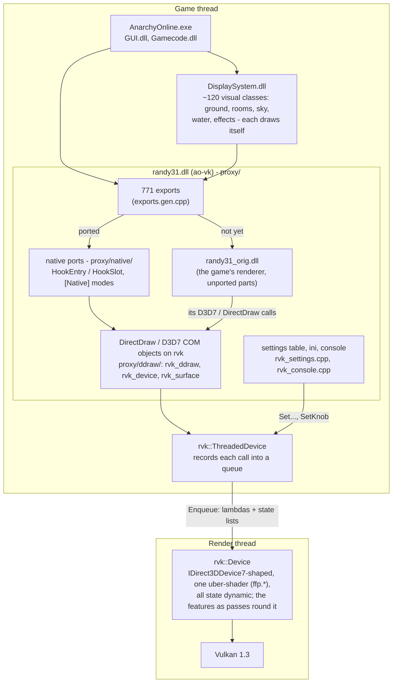
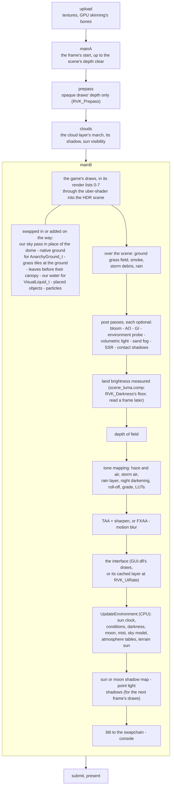
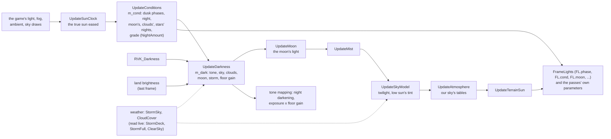

# The pipeline

How a frame gets from the game to the screen. Three views: the layers a draw call passes through, the GPU work
of one frame in order, and the per-frame state (time of day, weather, darkness) the passes read. The diagrams are
Mermaid (GitHub draws them). Details: docs/frame.md (the game's side), docs/rvk.md (the renderer),
docs/native.md (the native ports), docs/architecture.md (what must stay binary-identical).

## 1. The layers

The game never talks to Vulkan. Every draw comes through `randy31.dll` (ours), as Direct3D 7 calls, onto a renderer
thread.

## 2. One frame on the GPU

A frame is up to five command buffers, submitted in this order. The scene's commands are split at its depth clear
so that the depth pre-pass and the cloud march run before the scene's draws (`prepass.cpp` FrameCommands).

What runs where:

| Stage | Code |
| --- | --- |
| Draws, constants, frame lights | `rvk/draw.cpp`, `shaders/ffp*.glsl` |
| Depth pre-pass | `rvk/prepass.cpp` |
| Sky, stars, sun clock, conditions | `rvk/sky.cpp`, `rvk/atmosphere.cpp`, `shaders/sky_glow.frag`, `atmos_*.frag` |
| Clouds | `rvk/clouds.cpp`, `shaders/cloud_layer.frag` |
| Native ground, rocks, pebbles | `rvk/native_ground.cpp`, `ground_clutter.cpp`, `ground_pebbles.cpp`, `shaders/terrain.glsl` |
| Grass, leaves, water | `rvk/grass.cpp`, `leaves.cpp`, `water.cpp` |
| Rain, storms, wind, sand | `rvk/rain.cpp`, `wind.cpp`, `smoke.cpp`, `sand_map.cpp` |
| Post passes, tone mapping | `rvk/hdr.cpp`, `rvk/grading.cpp`, `shaders/tonemap.frag` |
| Darkness | `rvk/darkness.cpp`, `shaders/scene_luma.comp` |
| Moon, sun shadows, point shadows | `rvk/night.cpp`, `shadow.cpp`, `pointshadow.cpp` |
| Interface layer | `rvk/interface.cpp` |
| Present, frame start and end | `rvk/device.cpp` |

## 3. The world's state each frame

Once a frame, at its end, `UpdateEnvironment` brings the time of day and the weather up to date, in order. Each step
reads what the ones before it set. The draws and passes of the next frame read the results directly, or through the
frame lights (`FrameLights`, `shaders/frame_lights.glsl`).

The rule since the October 2026 audit (docs/audit-2026-10.md): a feature reads the world's state from `m_cond` and the
weather functions. It doesn't work out its own "how much is it night"; a new ramp goes into `Conditions` with a name.
